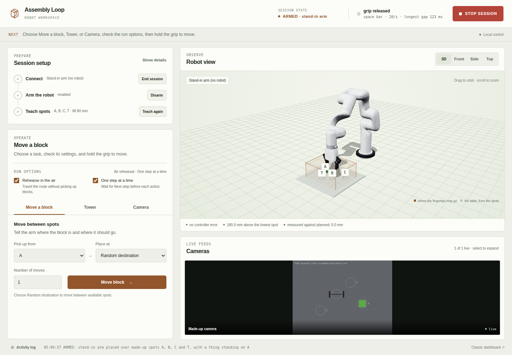

# assembly-loop



Hold-to-run assembly on a UFACTORY xArm 7. One local web page starts a session at the robot, teaches it places, arms
it, runs a task and stops it. Every motion goes through one guard, and the arm moves only while a person holds the
grip of a Quest controller.

Today it moves wooden blocks between places taught by hand and stacks them into a tower. Press-fit bricks and cables
are meant to follow on the same base.

> **Status, 23 November 2026.** Everything here is tested on a stand-in arm. On the real right arm, a session,
> the Quest grip and nudging have run; moving blocks, towers and the camera have not. The first session on the arm
> follows the rungs below, one at a time. The page that fits one screen (the model of the arm, the live pictures) has
> run on the stand-in arm only: its cameras have not been opened on the rig yet. The older page is kept at `/classic`.
> **New on 23 November, all of it on the stand-in arm and drawn pictures only:** a tower built with a look after every
> block, pushing blocks apart, recorded episodes and their export, the two arms fitted to each other and the other
> arm watched. What was found on the way and what comes next is in [docs/AUDIT.md](docs/AUDIT.md).

## Run it

It needs Python 3.9 or newer, numpy, and for a real arm UFACTORY's xArm Python SDK. Set these up once, in an
environment inside this folder, so that nothing else on the machine is touched:

```
git clone https://github.com/carlo-scr/assembly-loop.git
cd assembly-loop
python3 -m venv .venv
source .venv/bin/activate
pip install -e ".[real,eyes]"
```

`real` is the arm's SDK; `eyes` is OpenCV, for the live pictures and the camera that finds the blocks. After a
`git pull` that changes what is needed, run the `pip install` line again.

From then on, in every new terminal:

```
cd assembly-loop
source .venv/bin/activate
python -m assemblyloop dashboard
```

Then open `http://127.0.0.1:8777/` in a browser on the same machine.

## The page

It fits one screen and does not scroll:

- **Top left, the sequence:** session, checks, arm, places, run. Only the step that is next is spelled out.
- **Below it, the controls,** once armed: the nudge keys (W A S D, Q E, Z C, F R) while places are taught, then moving
  blocks, towers and the block finder.
- **Top right, a model of the arm** you are working with, in the pose the controller reports. Around it: the box the
  fingertips may be in, the taught spots, and a dashed line through every place the current move still goes to. Drag
  to turn it. It is a drawing: nothing is steered or judged by it.
- **Bottom right, the cameras** that belong to that arm (the two scene cameras and the two on its gripper), live. Every
  picture carries its age: one that stopped arriving turns grey and says for how long. Click a picture to enlarge it.
- **Top bar:** the state, what to do next, the hold-to-run signal, STOP SESSION.

Good to know:

- **The older page** (one long column, no model, no pictures) is at `http://127.0.0.1:8777/classic`. Same program,
  same buttons: use it if the new page misbehaves.
- **Cameras are opened only while the page is open,** and let go a few seconds after it is closed or hidden. With
  `--no_feeds` the page opens no camera at all.
- **The page needs no internet:** three.js and the arm's meshes are in `assemblyloop/web/`.

- **`python: command not found`** means the environment is not active in that terminal: run the `source` line.
- **`python3 -m venv` fails** (some Ubuntu installs lack it): with [uv](https://docs.astral.sh/uv/) installed, use
  `uv venv && uv pip install -e ".[real]"` instead of the two lines after `cd`.
- **The arm does not answer:** the machine needs an address on the arm's network (192.168.1.x) on its wired port.
  `ip -4 -brief addr` shows whether it has one.

- **Teleoperation must be closed first.** Both listen for the Quest on port 6666.
- **Without a robot,** choose "Stand-in arm" on the page. The space bar stands in for the grip.
- **Without the Quest:** `python -m assemblyloop dashboard --key_hold` lets the space bar of the page be the
  hold-to-run switch of a real arm. It counts only while the page is in front and has the keyboard.
- **The arms are mounted at 45 degrees,** rolled about their forward axis like shoulders. "Straight down" on the page
  takes that into account. On another rig: `--mount_deg 0` for an upright arm.
- **Other arm addresses:** `python -m assemblyloop dashboard --right 192.168.1.199 --left 192.168.1.219`
- **Read only:** `python -m assemblyloop status --ip 192.168.1.199` prints what the controller reports and changes
  nothing.

- **The Quest app finds this computer by itself** while a session is running: it is listed as
  "<computer name> (assembly-loop)". The headset must be on the arm's network (the "swoosh" Wi-Fi on this rig).

A session writes, under `assembly_logs/<date_time>/`, `guard.jsonl` (everything the arm was asked to do, and why each
move ended), `moves.jsonl` (one line per block moved) and `looks/` (every picture the block finder was given, and what
it made of it); under `assembly_logs/episodes/` one folder per recorded job (see "Recording"); and next to the program
`spots.json` and `spots.<arm>.json` (the taught places, per arm), `camera.json` and `camera.<arm>.json` (the camera's
fit) and `rig.json` (how the two arms stand to each other). None of these are tracked by git.

## What keeps the arm safe

- **Hold to run.** Motion needs the session armed *and* a fresh "grip held" signal from the headset. No signal counts
  as released. Letting go pauses within a moment; squeezing again continues.
- **One door to the arm.** Only the guard sends commands. It refuses anything outside a box around the taught places
  and anything faster than 120 mm/s (travel is 100, coming down 30, pressing 15).
- **Straight moves.** Translations at a fixed tilt, in segments of at most 80 mm (3 mm when contact is watched). The gripper turns by its last
  joint alone, 10 degrees at a time.
- **Contact is watched.** Lowering and lifting with a block go 3 mm at a time and compare where the joints are with
  where they were told to be. A move that meets something ends by itself.
- **Faults end the session.** A controller error, or a free move that ends up off its plan, stops the arm and the
  session stays stopped. The program never clears a controller error and never changes controller settings.
- **One headset.** The first headset heard is the switch until the session ends. Frames from any other sender, and
  frames without a running number, do not count.
- **The other arm.** Once the arms are fitted to each other (below) and the other arm answers, it is read (never
  enabled, never moved) and this arm starts no segment that could bring the two within 60 mm, takes shorter segments
  near it, and stops and ends the session if they are ever closer than that. An other arm that cannot be read counts
  as too close. Until the arms are fitted nothing is known about the other arm: the log says "NOT watched", and a
  person keeps it out of the way.
- **The page is local.** It answers on 127.0.0.1 only, and every button needs a token that only the served page has.

The red emergency stop stays within reach the whole time. Hold-to-run is not a substitute for it.

## First time on the real arm

One rung at a time. Stop at the first that misbehaves and keep the two log files.

1. `status` (above) prints a pose and `error 0`.
2. On the page, start a session on the arm. The label reads DISARMED, "Hold-to-run signal arriving" is ticked, and
   squeezing the Quest grip shows GRIP HELD.
3. Bring the gripper about 20 cm above the table with nothing near. Let go of the grip and press Arm. If the gripper
   does not point straight down (the lab's teleoperation leaves it tilted), hold the grip and
   press "Point the gripper down": it tilts 5 degrees at a time with the flange in place, the fingertips swing
   sideways, and it stops by itself if any joint moves much further than the tilt asks for. The label reads AWAITING CALIBRATION. Nothing may move, and "Measured against planned" reads under 1.5 mm.
4. Hold the grip, set the step to 1 mm and press Up once. Then 5 mm in each direction: each must go where its button
   says.
5. Set the step to 20 mm, press Up and let go of the grip half way. It must stop within a moment and go on when you
   squeeze again.
6. Turn by 5 degrees. Only the gripper spins; the rest of the arm stays still.
7. Open and close the gripper, first on nothing, then on a block held between the jaws. It says how wide the block is.
8. **Contact.** Put an empty cardboard box under the gripper, set the step to 1 mm and press Down repeatedly onto it.
   The nudge that meets the box must end by itself ("blocked: something is in the way") before the box is crushed.
   If it keeps pushing, stop: put nothing down on the table until this is understood.
9. Press STOP SESSION once on purpose. The label reads STOPPED and stays that way.

## Moving and stacking blocks

1. **Teach the places.** With the label at AWAITING CALIBRATION, stand a block where it should be picked up, nudge
   the open gripper around it (fingertips a few millimetres above the table) and press "Save spot here". Do the same
   for every other place, then press Done. A spot remembers how the gripper was turned there, so a block can be
   picked up one way round and put down another. The tilt of the gripper must be the same at every spot.
2. **One block.** Say where the block stands and where it goes, and press Go. Start with both boxes ticked: "rehearse
   in the air" does the whole travel without coming down, and "one step at a time" waits for a button before every
   step.
3. **A tower.** Stand one block on every spot except the one the tower goes on, choose that spot, enter the block
   height and press Build. The first block goes down at the taught height and each next one a block height higher,
   let go 2 mm above the block below. Take down returns every block to its own spot, top first.

## A tower from what the camera sees

One of the rig's scene cameras looks at the table. It finds the painted blocks on the grey mat, works out which block
each one is and how it lies, and the arm stacks them, widest at the bottom. Nothing is trained and nothing is
teleoperated. **This part has run on the stand-in arm and a made-up camera only (11 tests); it has not yet run on the
real arm or with the real camera.**

It needs OpenCV: `pip install -e ".[real,eyes]"` (with uv: `uv pip install -e ".[real,eyes]"`).

1. **Measure the blocks.** Copy `blocks.example.json` to `blocks.json` and enter every kind of block with its
   colour and its sizes in millimetres (a box: three edges; a cylinder: diameter, length). The sizes in the example
   are guesses. `finger_mm` is how deep a block can sit between the fingers, `jaw_mm` how far the jaws open.
2. **Find the table.** With the gripper pointing straight down over the middle of the area, close it on a bar held
   level between the jaws (jaws across its short side), press "Find the table" and hold the grip. The gripper comes
   straight down at 15 mm/s until the bar meets the mat, lets go, and makes the spots itself: T where the bar lies
   (the tower will stand there) and P and Q at opposite corners of the area. Or teach the spots by hand.
3. **Show the camera the table** (Camera card, once, and again whenever the camera or the table was moved). Lay one
   bar flat on a taught spot, the jaws across its short side, say which spot under "The block stands on", keep
   everything else off the mat, and hold the grip. The arm carries the bar to a dozen places and steps aside for a
   picture after each. From where it put the bar and where the camera saw it, the camera is fitted and kept in
   `camera.json`. The log says within how many millimetres the camera then finds the bar; more than 6 mm is refused.
4. **Look.** Lay blocks on the mat, apart from each other and away from the tower spot, move the arm out of the
   camera's view, and press Look. The picture shows what was made out, the order of the tower, and what is left out
   and why.
5. **Build a tower from what it sees.** Rehearse in the air first. Every block is taken across its short side and put
   down the way it lay; tall blocks are held near their top.

What it does not do yet: blocks of one colour that touch are one patch and are not made out; a lying cylinder is left
out (it rolls); a block is never turned over; the tower and the travel above it stay under 300 mm; "Build a tower from what it sees" does
not check that the jaws have room beside a block (the build with a look after every block does). `python -m assemblyloop look`
takes one picture and writes `look.jpg` with what the camera makes out, without any arm; `python -m assemblyloop look
--again assembly_logs` reads every picture the sessions kept once more and says where the block finder now sees
something else than it did then (the way to try a change to it on real pictures).

## A tower with a look after every block (the Loop tab)

**Stand-in arm and drawn pictures only so far.** "Build a tower from what it sees" above plans every block from one
picture and never looks again. "Build, looking after every block" lets the arm step aside after every block (above the
taught spot farthest from the tower), and the next picture decides what happens next:

- **Is the last block where it was put?** Its outline is drawn at the height it should stand at and fitted to its
  colour. Found: the next block is aimed half way between where it really stands and the tower's own axis. Not found:
  it fell, and is taken again from wherever it lies now. A tower whose top stands more than 30 mm off its foot ends
  the job.
- **Which block next?** Planned anew from every picture, so blocks may be added, moved or taken away while it runs.
- **Can the jaws get at it?** The jaws open only 10 mm wider than the block on either side. A block with another
  one where a finger would come down is first pushed clear with the closed gripper; a patch of colour that is not
  made out as a block (two that touch, one half hidden) is pushed apart, from another side at every attempt. A push
  is watched like a lowering: 3 mm at a time, and it ends where something does not slide. "push apart" unticked: such
  blocks are left and said.
- **Is it the block the camera named?** The gripper says how far apart its jaws stopped; more than 6 mm from the
  block's width and it is let go again where it stood. If the gripper's counts turn out not to be tenths of a
  millimetre on this rig (rung 7 says), untick "check widths".
- Three failures in a row end the job and ask for a person. That is not a fault: the session stays ARMED.

"Build and spread, for the rounds" is for collecting data: after every tower the blocks are taken down and laid at
places and angles picked at random inside the area the camera was shown, and the next tower starts from there.

## Recording (the Loop tab)

While a job runs, ten times a second: every arm's joints, pose and gripper as its controller publishes them, what it
was last asked for (the segment's goal, the gripper's opening), whether the switch is held, the step and the sub-task
in words, and the newest picture of every camera of the arm (the cameras are opened for the recording even when the
page shows none). One job is one episode in `assembly_logs/episodes/<date_time>_<n>/`: `episode.json` (the task in
words, how it ended), `rows.jsonl`, `events.jsonl` (steps, sub-tasks, what the camera saw, pushes, blocks that fell)
and `cam/<camera>/*.jpg`. A rehearsal in the air is never marked a success. "last episode: good / bad" is a person's
word on it, which counts for more than "the steps ran". `--no_record` records nothing; `--record_hz` sets the rate.

```
python -m assemblyloop export assembly_logs out/blocks --npz              # one .npz per episode, numpy only
pip install -e ".[export]"                                                # LeRobot (brings torch; Python 3.12 or newer)
python -m assemblyloop export assembly_logs out/blocks you/assembly_blocks
```

The state is each arm's seven joint angles in radians and its gripper's opening from 0 to 1 (right arm first); the
action is the same one row later, with the gripper as it was asked for; rows in which nothing moves are cut. The
LeRobot path has run against lerobot 0.7.0 (dataset format v3.0). openpi pins an older LeRobot (format v2.1): for
pi0.5, run the export inside openpi's own environment; that path is written from its source and has not been run.

## Two arms

**Stand-in arms only so far.** The arms are fitted to each other from marks on the table that both have touched:

1. Stick five or more marks on the mat, spread out, where both arms reach.
2. With the right arm: point the gripper down, nudge the fingertips onto each mark and save it as a spot (M1, M2, ...).
   Press Done. With the left arm, in its own session: the same marks under the same names.
3. On the Loop tab press "Fit the arms to each other" (or `python -m assemblyloop pair`). A mark that does not agree
   with the others is named; a fit that disagrees with how the arms are mounted is refused. It is kept in `rig.json`.

From then on a session on either arm watches the other one (see "What keeps the arm safe"), and the left arm needs
no teaching of its own: in a session on it, nudge it over the area and press "Use the other arm's spots". The right
arm's spots and the camera's fit are carried over into the left arm's frame. **Rehearse in the air first**: nothing
checks that the left arm can reach every place, and the carried-over heights are only as good as the fit. Both
grippers must be the same length, and neither controller may have a tool offset set.

What this is not yet: both arms moving in one session. One program still has one arm; the other is seen and kept
away from. See [docs/AUDIT.md](docs/AUDIT.md) for the rungs towards two arms working on one tower.

## Layout

```
assemblyloop/
  arms.py       the few calls made to the arm, and a stand-in arm with the same calls
  deadman.py    hold-to-run: the Quest grip, or the space bar with the stand-in arm
  guard.py      the only door to the arm: limits, segments, pause, stop, log
  cycle.py      a task as a list of named steps, and their execution through the guard
  spots.py      places taught by hand; moving a block between them; the levels of a tower
  blocks.py     the kinds of block (blocks.json), how each can lie, and which goes onto a tower next
  eyes.py       the camera: coloured patches, the camera fitted to the table, which block each patch is
  sight.py      the camera in a session: show it the table, look, build a tower from what it sees
  plate.py      a stud plate taught from three poses (press-fit bricks; command line only for now)
  closed.py     a tower with a look after every block: is it there, which next, can the jaws get at it; pushing; spreading
  record.py     what the robot did and what the cameras saw while a job ran, as episodes
  export.py     episodes as a LeRobot dataset, or as .npz
  pair.py       two arms: fitted to each other from marks, what one knows carried over to the other, how near they are
  session.py    one session: OFF, DISARMED, AWAITING CALIBRATION, ARMED, RUNNING
  feeds.py      the live pictures: one owner per camera, lent to the block finder for its own picture
  dashboard.py  the local web server of a session, and the older page
  web/          the page that fits one screen (index.html, app.css, app.js), the model of the arm (scene.js),
                three.js (vendor/, MIT) and UFACTORY's xArm 7 meshes (xarm7/, BSD-3-Clause, from MuJoCo Menagerie)
tests/          the safety rules and the session, on the stand-in arm
```

## Tests

```
pip install -e ".[dev]"
pytest -q
ruff check .
```
